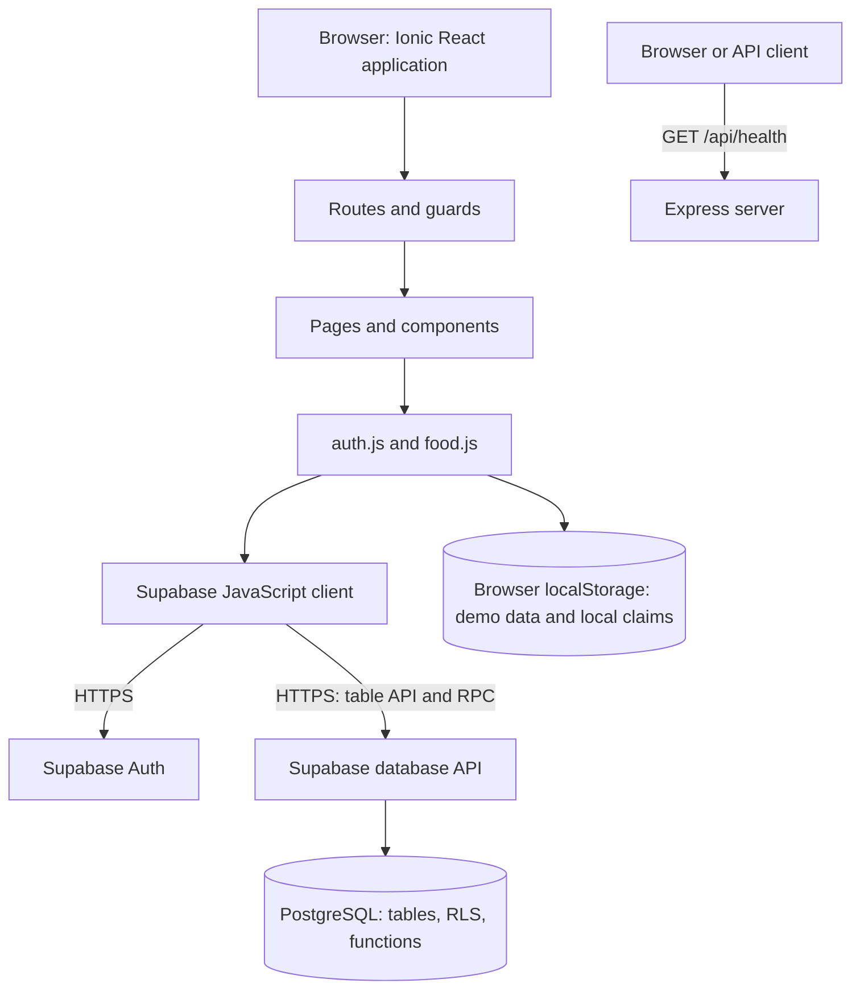

# FoodRescue: Code Structure and Engineering Study Guide

Prepared from the current source checkout on October 16, 2026. Audience: an intermediate programmer preparing to explain the system to a professor.

This is a study roadmap and presentation reference. Source inspection establishes what the code contains; it does not establish which migrations are deployed or whether a live service works. The implementation includes demo behavior alongside Supabase operations. Requirements in other documents describe a broader target.

## Contents

1. [The explanation to start with](#1-the-explanation-to-start-with)
2. [Repository structure](#2-repository-structure)
3. [Learning checklist](#3-learning-checklist)
4. [Frontend startup and navigation](#4-frontend-startup-and-navigation)
5. [React component and state engineering](#5-react-component-and-state-engineering)
6. [Frontend styling and interaction engineering](#6-frontend-styling-and-interaction-engineering)
7. [HTTP requests and system boundaries](#7-http-requests-and-system-boundaries)
8. [Authentication and authorization](#8-authentication-and-authorization)
9. [End-to-end feature flows](#9-end-to-end-feature-flows)
10. [Database structure and business logic](#10-database-structure-and-business-logic)
11. [Express backend](#11-express-backend)
12. [Shared types, tooling, and testing](#12-shared-types-tooling-and-testing)
13. [Current limitations and intended behavior](#13-current-limitations-and-intended-behavior)
14. [Professor presentation plan](#14-professor-presentation-plan)
15. [Practice questions](#15-practice-questions)
16. [October 16 implementation and learning update](#16-october-16-implementation-and-learning-update)

## 1. The explanation to start with

> FoodRescue connects campus members offering surplus food with members requesting portions. It is organized as an npm workspace monorepo containing an Ionic React frontend, an Express TypeScript backend, shared type definitions, and Supabase database migrations. The current frontend uses the Supabase JavaScript client directly for authentication and database operations. Express currently provides a health endpoint. Some screens and claim operations use browser-local demo data, so the prototype does not yet implement every documented workflow.

Two different server responsibilities exist:

- **Supabase:** the managed backend used by the frontend for authentication and database requests.
- **Express:** the project's custom server, currently a small API foundation.



Do not draw the current food flow as frontend → Express → Supabase. That would describe an architecture this checkout does not implement.

## 2. Repository structure

```text
FoodRescue/
├── package.json                 npm workspace definitions and root commands
├── package-lock.json            resolved dependency versions
├── apps/
│   ├── frontend/
│   │   ├── index.html           HTML entry and React root container
│   │   ├── vite.config.js       React/Tailwind build plugins and @ alias
│   │   └── src/
│   │       ├── main.jsx        mount React; install Ionic/router wrappers
│   │       ├── App.jsx         routes, member layout, page transitions
│   │       ├── styles.css      global CSS, tokens, responsive rules
│   │       ├── guards/         authentication and admin route checks
│   │       ├── modules/auth/   login and registration screens
│   │       ├── modules/admin/  admin interface
│   │       ├── modules/        auth, admin, feed, post, map, history, profile
│   │       ├── components/     auth controls, food cards, shared layout and UI
│   │       │   └── ui/calamansi/ reusable visual/animation components
│   │       ├── services/       Supabase access and demo persistence
│   │       └── lib/            validation and visual utilities
│   └── backend/
│       └── src/
│           ├── index.ts       Express setup and middleware
│           ├── routes/        health route
│           └── config/        Supabase client configuration
├── packages/shared/src/        TypeScript domain and API definitions
├── supabase/migrations/        SQL schema, policies, triggers, functions
├── docs/                       specifications, walkthroughs, decisions
└── CONTEXT.md                  domain terminology and intended rules
```

**Concept:** A monorepo contains several related packages in one repository. An npm workspace links local packages and lets root commands run their scripts. It does not automatically make every package participate in every runtime request.

## 3. Learning checklist

Check an item when you can explain it using a file or concrete example, rather than only recognizing the term.

| Learn | Concept | Demonstration in this project |
|---|---|---|
| [ ] | Monorepo and npm workspaces | Explain root `package.json` and the three packages |
| [ ] | Browser versus server execution | Identify where JSX, Express, and SQL run |
| [ ] | ES modules and imports/exports | Follow `HomeFeed` importing `getFoodPosts` |
| [ ] | JSX and functional components | Explain how a `FoodCard` describes UI |
| [ ] | Props and callbacks | Trace `post`, `userProfile`, and `onClaimSuccess` |
| [ ] | State and rendering | Explain `posts`, `portion`, `loading`, and error state |
| [ ] | Effects and cleanup | Explain initial loading and removing event listeners |
| [ ] | Derived state | Explain why filtered posts are calculated from existing state |
| [ ] | List keys and component identity | Contrast post IDs with pathname-based page keys |
| [ ] | Controlled forms and validation | Trace `PostPage` fields through validation |
| [ ] | Promises and async/await | Explain how the UI waits without blocking all interaction |
| [ ] | Routing and navigation state | Trace a dock click through `history.push` |
| [ ] | Layout and responsive CSS | Explain flex/grid, breakpoints, overflow, positioning |
| [ ] | Ionic versus React | Identify their separate responsibilities |
| [ ] | Animation and visual primitives | Explain Motion, tilt cards, and squircles |
| [ ] | Accessibility | Explain labels, alt text, focus, keyboard and touch behavior |
| [ ] | HTTP and JSON | Explain method, URL, headers, body, status, response |
| [ ] | SDK versus API versus database | Trace a Supabase call across these boundaries |
| [ ] | Authentication versus authorization | Contrast a session with permission to change a row |
| [ ] | RLS and server-side validation | Explain why hiding UI cannot protect data |
| [ ] | Relational data | Explain profile/post/claim foreign keys |
| [ ] | Transactions and concurrency | Explain why reserving portions belongs in a database operation |
| [ ] | Browser storage versus shared storage | Explain localStorage limitations |
| [ ] | Middleware, CORS, and HTTP handlers | Trace `/api/health` through Express |
| [ ] | Types versus runtime validation | Explain what shared TypeScript definitions do and do not enforce |
| [ ] | Development versus production builds | Explain Vite, TypeScript compilation, and environment variables |
| [ ] | Testing and evidence | Distinguish validation unit tests from integration and device testing |
| [ ] | Prototype versus intended system | Explain the gaps listed in section 13 |

## 4. Frontend startup and navigation

Read in order:

1. `apps/frontend/index.html`
2. `apps/frontend/src/main.jsx`
3. `apps/frontend/src/App.jsx`
4. `apps/frontend/src/guards/AuthGuard.jsx`
5. `apps/frontend/src/guards/RoleGuard.jsx`
6. `apps/frontend/src/components/layout/PageShell.jsx`
7. `apps/frontend/src/components/layout/FloatingBottomDock.jsx`

`index.html` contains `<div id="root"></div>` and loads `main.jsx`. React's `createRoot(...).render(...)` mounts the application there. The component tree starts with `StrictMode → IonApp → IonReactRouter → App`. `setupIonicReact()` initializes Ionic before mounting. App mounts a shared `BlocksBackground` outside the pathname-keyed page transitions.

- `StrictMode` enables extra development checks; effect setup/cleanup should tolerate development re-execution.
- `IonApp` is the Ionic app container.
- `IonReactRouter` supplies navigation context.
- `App` uses React Router v5 `Switch`, `Route`, and `Redirect` to select screens.

Public routes include `/login` and `/register`. `/app` is wrapped in `AuthGuard`. Admin routes use `RoleGuard` with `allowedRole="admin"`.

`AuthGuard` owns loading/profile state. It calls `getCurrentProfile()` in an effect, then either renders the requested component with a `userProfile` prop or redirects to login. `RoleGuard` also compares the profile role. These are frontend navigation decisions.

The member layout renders the selected page inside a Motion container, with the dock outside it. `PageShell` gives pages common `IonPage` and `IonContent` wrappers. The dock computes slide direction from tab order and passes it in navigation state.

**Important consequence:** the animated wrapper uses `key={location.pathname}`. Moving to another path creates a new page subtree; local form state can reset when returning. A persistent dock does not imply persistent page state.

## 5. React component and state engineering

### Components and responsibility

| File under `apps/frontend/src/` | Main responsibility |
|---|---|
| `modules/feed/HomeFeed.jsx` | Load listings, filter by category/search, display cards and claim feedback |
| `components/food/FoodCard.jsx` | Show a listing, portion controls, detail modal and claim action |
| `modules/post/PostPage.jsx` | Manage form fields, image previews, validation and publishing |
| `modules/history/HistoryPage.jsx` | Display local claim records and local completion controls |
| `modules/map/MapPage.jsx` | Leaflet/OpenStreetMap tiles, category pins, consented user location and distance radius |
| `modules/profile/ProfilePage.jsx` | Profile display, demo-derived impact metrics and sign-out confirmation |
| `components/layout/CustomerHeader.jsx` | Common header and local pickup-pass interaction |
| `components/layout/FloatingBottomDock.jsx` | Member navigation and visual indicators |
| `modules/admin/AdminDashboard.jsx` | Admin sections, currently largely demo content |
| `services/food.js` | Listing/claim operations and persistence |
| `services/auth.js` | Login, registration, profile, OAuth and logout |
| `lib/validation.js` | Reusable input validation and safe array parsing |

### Props, state, effects, and callbacks

- **Props:** inputs from a parent. `FoodCard` receives `post`; member pages receive `userProfile`.
- **State:** changing component-owned values. `FoodCard` owns selected portion count and whether it is claiming.
- **Effects:** synchronize with something outside rendering. `HomeFeed` loads listings when mounted. `HistoryPage` subscribes to browser events and cleans up its listener.
- **Callbacks:** children notify parents. `FoodCard` calls `onClaimSuccess(claim)`; `HomeFeed` displays a message.
- **Derived values:** calculate from existing inputs. `HomeFeed` filters `posts` using `category` and `searchQuery`; it does not need a second independent copy of the filtered list in state.

React rerenders when state changes. Writing to localStorage alone does not notify React. This project explicitly dispatches `foodrescue:claim_updated`; subscribed components reread claims and update their state. That browser event is not a network request or a Supabase realtime subscription. The dock reads claims during rendering but does not itself subscribe to that event, so every indicator is not guaranteed to refresh immediately.

### Form behavior

`PostPage` uses controlled fields: state contains each value, and input handlers update that state. Submission calls `preventDefault()`, validates, sets loading/error state, awaits the service, then resets fields after success.

Validation covers name length, description, supported category, integer portions from 1–100, address length, a 15-minute to 24-hour duration, and at least one photo. Image selection checks image MIME type and a 5 MB size limit. Client checks provide feedback; authoritative data rules must also live on the server/database.

**Avoid a common misunderstanding:** displaying a success toast does not prove every relevant component refetched its data. In the current feed, the success callback displays feedback; it does not itself reload the posts array.

## 6. Frontend styling and interaction engineering

### How the visual layers work

- **Ionic:** initialized app/page/content containers. The feed search and post category/submit controls use native HTML elements; listing cards use a single `article` surface to avoid overlapping rounded wrappers. Ionic styles are imported into the CSS base layer so Tailwind utilities can override defaults.
- **Tailwind:** utilities inside JSX `className`, compiled through the Tailwind Vite plugin and `@import "tailwindcss"`.
- **Global CSS:** `styles.css` defines tokens, fonts, shared styles, Ionic adjustments and media queries.
- **Motion:** animated elements and enter/exit transitions through `motion` and `AnimatePresence`.
- **Shared surfaces:** `BlocksBackground` uses fixed SVG coordinates for a stationary pastel grid; `LiquidGlassCard` supplies blur, translucency, highlights and a solid fallback. Neither is evidence of a downloaded third-party registry component.
- **Local primitives:** `components/ui/calamansi/` contains dock, duration picker, dynamic island, marquee, tilt card, number ticker and other reusable visual components.
- **Shape utilities:** `lib/squircle.jsx` measures bounds and calculates smoothed SVG clipping paths. `lib/liquid.jsx` supplies visual fusion/filter and spring utilities.
- **Class utilities:** `cn()` combines conditional class names using `clsx` and resolves Tailwind conflicts with `tailwind-merge`.

For example, `flex flex-col sm:flex-row` describes a column layout that changes to a row at the configured small breakpoint. `fixed` attaches the dock to the viewport; `absolute` positions page animation layers inside a positioned parent. `overflow-y-auto` creates scrollable content. Bottom padding helps keep content clear of the dock.

The theme uses green/pale backgrounds, DM Sans and Space Grotesk, rounded surfaces, shadows and animated interactions. Explain these as implementation choices; their presence does not establish usability or accessibility quality.

### Concepts to inspect during a live demonstration

- Which element owns scrolling: Ionic content, an inner container, or the document?
- How do max-width containers and responsive utilities change the layout?
- Do loading, error, empty and success states communicate what happened?
- Can controls be reached with a keyboard and understood through accessible labels?
- Do modals manage focus, dismissal and focus return correctly? Verify rather than assume.
- Does hover-dependent behavior still work on touch devices?
- Are animations appropriate for reduced-motion preferences? Verify rather than assume.
- Do images have useful alternatives and sensible sizing?

## 7. HTTP requests and system boundaries

### The basic request/response model

An HTTP request has a method, URL, headers, and sometimes a body. A response has a status, headers, and sometimes a body. JSON is a common text format for API data. HTTPS adds transport encryption.

| Term | Meaning | FoodRescue example |
|---|---|---|
| GET | Request a representation | Load food posts or request `/api/health` |
| POST | Submit an operation or new resource | Insert a food post or invoke `claim_food` |
| PATCH | Partially update a resource | General API concept; current `completeClaim` is local, not a remote PATCH |
| Header | Metadata about a request/response | Content type, API key, user access token |
| Body | Submitted payload | Claim post ID, claimant ID and requested quantity |
| 2xx | Successful HTTP response family | Successful health response |
| 4xx | Request/auth/resource-related error family | Express returns 404 for an unknown route |
| 5xx | Server error family | Express error middleware returns 500 |

### Where requests are actually made

`supabase.from(...).select(...)` looks like a local JavaScript method chain, but the Supabase client sends HTTP requests to the configured Supabase service. PostgreSQL does not execute inside the browser. The frontend receives decoded data/errors and uses React state to update the UI.

These are representative Supabase request shapes inferred from the SDK calls, not captured network traces. Exact query encoding and headers should be inspected in browser developer tools:

```http
GET https://<project>.supabase.co/rest/v1/food_posts?...filters...
POST https://<project>.supabase.co/rest/v1/food_posts
POST https://<project>.supabase.co/rest/v1/rpc/claim_food
```

The claim RPC sends a JSON payload shaped like:

```json
{
  "post_id": "<post UUID>",
  "claimant_id": "<signed-in user UUID>",
  "qty": 2
}
```

An RPC is a remote procedure call: the client asks the server to execute a named function. Here that function is defined in SQL migrations.

### Operations that do not inherently send HTTP

- Updating React state or filtering the already-loaded feed.
- Reading/writing localStorage or dispatching a custom browser event.
- Calling `history.push` to change an SPA route. Mounting the new page may subsequently trigger data requests.
- Creating an image preview with `URL.createObjectURL(file)`.

A full page load still requests HTML/JavaScript/CSS, and remote images/fonts make their own requests. Separate asset requests from business-data requests when explaining the Network panel.

### How to inspect a request for your professor

1. Open developer tools → Network and filter to Fetch/XHR.
2. Perform one action, such as loading the feed with Supabase configured.
3. Identify the destination host: Supabase or the local Express server.
4. Explain the method, URL, filters/body, status and response data.
5. Trace the response into service return values and React state.
6. Do not expose tokens or credentials in screenshots or presentation slides.

## 8. Authentication and authorization

Read `services/supabase.js`, `services/auth.js`, the guards, and the SQL migrations together.

### Configuration

The frontend uses `VITE_SUPABASE_URL` and `VITE_SUPABASE_ANON_KEY`. Vite exposes `VITE_` values to client code; they must be treated as browser-visible. The anonymous client key is intended for client use with appropriate database policies. A service-role credential belongs on a trusted server and must not be placed in the frontend.

When those frontend settings are absent, the app uses demo identities. Demo login does not validate the password against a real authentication service. It is demonstration behavior, not production authentication.

### Configured login

```text
Login screen
  → auth.login(email, password)
  → Supabase Auth signInWithPassword
  → session/user result
  → query profiles by user ID
  → try to provision a missing profile
  → route to the appropriate screen
```

Registration uses Supabase `signUp` with name/phone/role metadata. The database includes a trigger that provisions a profile, with later migrations restricting which roles new users can request. Email confirmation may be required depending on the Supabase configuration. Google sign-in uses an OAuth redirect back to `/login`.

**Authentication** answers who the user is. **Authorization** answers what the user may do. Route guards improve navigation; row-level security policies and database functions must enforce data permissions. Supabase supplies the authenticated user identity to SQL through `auth.uid()`.

## 9. End-to-end feature flows

### A. Loading and searching food

```text
HomeFeed mounts
  → useEffect calls fetchPosts
  → loading=true; clear previous error
  → food.getFoodPosts()
  → configured: select active food_posts with donor fields
  → remote failure: throw and show a friendly retry state
  → empty remote result in development only: use local/sample posts
  → no Supabase configuration: use local/sample posts
  → setPosts(data); loading=false
  → filter posts by category/search
  → render FoodCard for each result
```

An empty successful remote result uses samples only in development; a configured production build preserves the empty result. Remote failures are surfaced, not silently replaced with samples. Unconfigured builds use local/sample data. The six defaults have `is_sample: true`; sample claims skip the remote RPC. Seeing samples does not prove remote persistence. Search is currently performed on the loaded array, not through a new search API request.

### B. Publishing food

```text
PostPage controlled form
  → validateFoodPostDraft
  → createFoodPost
  → configured: get session, insert food_posts row, read inserted result
  → unconfigured: create browser-local record and save it
  → return result
  → display success and reset fields
```

The service maps UI names such as `foodName` and `pickupAddress` into database columns such as `food_name` and `pickup_address`. It computes `expires_at` from the chosen duration. Current remote inserts use fixed coordinates.

Photo selection currently produces temporary blob URLs and passes the first preview URL to the service. This path does not upload file bytes to Supabase Storage. A preview URL is not a durable shared image URL, even if its text is saved in a database row.

### C. Claiming portions

```text
FoodCard handleClaim
  → validate selected quantity
  → set claiming state
  → food.claimFoodPost(post, portionCount)
  → configured, non-sample listing: verify session and call claim_food RPC
  → sample listing: keep the claim on this device
  → build separate local claim record
  → save local claims and inventory
  → dispatch foodrescue:claim_updated
  → callback shows success feedback
```

The database RPC conditionally decreases available quantity and inserts a claim. The browser additionally creates a local record with a generated display code. Those are different records with different IDs and status representations; the RPC currently returns no claim record for the frontend to reuse.

### D. History and pickup

`getActiveClaims()` currently reads the local claims array, despite its name suggesting a filtered remote query. `HistoryPage` and `CustomerHeader` listen for local updates. `completeClaim()` changes local status to `picked_up`; it does not send database pickup confirmation. Profile metrics incorporate local completions plus a hardcoded baseline.

## 10. Database structure and business logic

The migrations define these tables:

| Table | Purpose | Key relationships |
|---|---|---|
| `profiles` | Application identity, role and status | ID references Supabase `auth.users` |
| `food_posts` | Donor listings and available quantities | `donor_id` references profiles |
| `claims` | A member's reservation against a listing | References food post and claimant profile |
| `notifications` | Member messages | References recipient; optional related post |
| `reports` | Complaints about posts/users | References reporter; target type and ID identify subject |
| `admin_logs` | Administrative activity records | References admin |

A primary key uniquely identifies a row. A foreign key connects related rows and constrains references. Check constraints limit values, such as positive quantities and allowed status strings. Indexes help selected query patterns; they do not replace constraints or permission checks.

### Atomic reservation

Inspect the latest `claim_food` definition in `supabase/migrations/20261003000000_harden_auth_and_claims.sql`, rather than only its earlier definition.

It checks that the authenticated ID matches the claimant and that quantity is positive. It then performs a conditional update:

```sql
update public.food_posts
set quantity_remaining = quantity_remaining - qty,
    status = case
      when quantity_remaining - qty <= 0 then 'fully_claimed'
      else status
    end
where id = post_id
  and quantity_remaining >= qty
  and status = 'active';
```

If no row was updated, it raises an error. Otherwise it inserts a claim, whose table default is `pending`. PostgreSQL executes this function within the request's transaction: a failure rolls back its changes.

**Why this matters:** if two users request the last portion, trusting each browser's previously loaded count can oversell it. The conditional database update uses the authoritative row and PostgreSQL concurrency control. This handles the available-quantity race for this RPC; it does not prove that every alternate write path enforces every business rule.

The inspected function does not check `expires_at`, self-claiming, suspension, or per-person claim limits. Those documented requirements should not be claimed as fully enforced by this function.

### Migrations, RLS and triggers

- Migrations record database changes in order. Later files can replace earlier functions and policies.
- RLS evaluates which rows a request may access using database-side rules.
- Triggers run automatically for specified database events, such as inserting an auth user or updating a profile role.
- A `security definer` function runs with its owner's privileges. Its explicit validation and permissions deserve careful review; it must not trust caller-supplied identity alone.
- A migration file existing locally does not prove it has been applied to the hosted project.

## 11. Express backend

Read `apps/backend/src/index.ts` and `routes/health.routes.ts`.

```text
HTTP request
  → CORS middleware
  → JSON body parser (1 MB limit)
  → matching route
  → JSON response
  → unmatched requests: 404 handler
  → propagated errors: error middleware, 500 response
```

The server defaults to port 5000. Mounting `healthRouter` at `/api` combines with its `/health` route to produce `GET /api/health`. The response uses the shared `ApiResponse` type and includes a service name and timestamp. `GET /` describes the API. Unknown routes return JSON with status 404.

**Middleware** is a function in Express's request-processing chain. Order matters. **CORS** controls which browser origins may read cross-origin responses; it is not user authentication. `localhost` and `127.0.0.1` are different hostnames/origins, so allowed origins must match the client address.

`config/supabase.ts` defines a server-side client, preferring a service-role key when configured. The current server entry and health route do not import it or use it to process food operations. A configuration file's existence is not evidence of a connected feature.

Do not claim that a healthy `/api/health` response proves Supabase is reachable: this handler does not query Supabase.

## 12. Shared types, tooling, and testing

### Shared definitions

`packages/shared/src/index.ts` declares profiles, food posts, claims, notifications, roles, status unions and `ApiResponse<T>`. Shared types help consumers agree on shapes at compile time. They do not validate JSON at runtime or create database tables.

The frontend currently uses JavaScript/JSX and does not automatically enforce these TypeScript contracts. Schema, shared definitions and local data can drift: local claims use `quantity` and `ready_for_pickup`, while database claims use `quantity_claimed` and default to `pending`. Compare actual fields before treating these models as interchangeable.

### Development and build commands

| Root command | Purpose |
|---|---|
| `npm run dev` | Start frontend and backend concurrently |
| `npm run dev:frontend` | Start Vite; configured host `127.0.0.1`, port 5173 |
| `npm run dev:backend` | Run Express with `tsx watch` |
| `npm run build` | Build shared package, then workspace build scripts |
| `npm run build:frontend` | Produce frontend assets with Vite |
| `npm run build:backend` | Compile backend TypeScript |
| `npm test` | Run frontend library test files through Node's test runner |
| `npm run db:push` | Push migrations using Supabase CLI; this changes the configured database |

Vite transforms frontend source and builds browser assets. TypeScript compilation produces JavaScript/types for the TypeScript packages. A browser cannot execute TypeScript type declarations as application behavior. Ionic React being installed does not by itself produce an Android APK; native packaging is a separate delivery step.

### Verification boundaries

The Node test runner currently executes 11 tests across `lib/validation.test.js`, `lib/sample-food.test.js`, and `lib/map.test.js`, covering validation, phone limits, safe errors, abort timeouts, sample data, and map coordinate/listing checks. Such tests do not establish working OAuth, database RLS, concurrent claims, remote uploads, responsive layouts, keyboard access, or Android behavior. Those require appropriate integration, browser or device checks. On October 16, 2026, `npm run build:frontend` and `npm test` passed after the location/radius changes (11 tests). Earlier local browser checks exercised forms, modal dismissal, card layout, carousel filtering and timed advancement. Actual location permission, device positioning and map tile behavior were not verified in the signed-out browser; deployment and live OAuth remain unverified.

## 13. Current limitations and intended behavior

Use this table when the professor asks whether a feature is fully implemented.

| Area | Current inspected behavior | Broader intended behavior / explanation |
|---|---|---|
| Food API | Frontend directly uses Supabase | Express food endpoints are not present |
| Feed fallback | Six labeled samples in unconfigured mode; empty configured development feed falls back; configured failures show errors | Samples are not live database inventory |
| Claim status | Database `pending`; separate local `ready_for_pickup` | Intended pending claims await donor approval |
| Pickup completion | Local mutation available from claimant UI | Intended donor verification and shared completion |
| Claim history | Browser-local array, not scoped by signed-in user in its storage key | Intended account-specific, shared history |
| Claim code | Locally generated display code | Not evidence of secure donor QR verification |
| Deadline | Stored/displayed; inspected claim RPC does not enforce it | Intended strict deadline checks |
| Photos | Local object URL previews passed to service | Intended durable file upload and shared URL |
| Location | Interactive OpenStreetMap, category icons, opt-in current position, accuracy circle and adjustable straight-line radius; remote publishing still inserts fixed coordinates | Donors still need real coordinate capture; walking routes and journey sharing are not implemented |
| Admin | Demo arrays, static metrics and placeholder broadcast feedback | Intended live audited moderation |
| Impact metrics | Demo baseline plus local completion count and multipliers | Not independently measured environmental impact |
| Delivery | Vite web application and Ionic components | Android APK remains a separate implementation/verification task |

The intended domain vocabulary is in `CONTEXT.md`; the broader agreement is in `docs/Design_Agreement_FoodRescue.md`. Treat these as requirements, not proof that the code implements them.

## 14. Professor presentation plan

### Suggested eight-minute walkthrough

1. **Purpose (30 seconds):** explain donor, claimant, listing and reservation.
2. **Architecture (one minute):** show the diagram and distinguish Supabase from Express.
3. **Repository (one minute):** explain `apps`, `packages`, migrations and docs.
4. **Frontend startup (one minute):** show `main.jsx → App.jsx → AuthGuard → HomeFeed`.
5. **Frontend engineering (one minute):** show component composition, state, props, responsive styling and navigation.
6. **One request flow (90 seconds):** trace `FoodCard → claimFoodPost → Supabase RPC → PostgreSQL → local feedback`.
7. **Backend and database (one minute):** explain health middleware, RLS and atomic quantity updates.
8. **Evidence and gaps (one minute):** separate demo features, implemented remote operations, and planned workflows.

### A concise frontend explanation

> The frontend is built from React functional components. App selects a screen using the URL, guards load the member profile, and pages receive that profile through props. Pages own interaction state and call service functions for data operations. Ionic provides app and control primitives, Tailwind and CSS define layout and appearance, and Motion handles transitions. Supabase requests are made in service modules rather than being routed through our Express server.

### A concise HTTP explanation

> When a configured user claims food, the component calls a service function. The Supabase SDK sends an HTTPS RPC request carrying the post ID, claimant ID and quantity. The database function verifies the caller, conditionally reduces inventory and inserts a pending claim. The response resolves the awaited operation. Our prototype then creates a separate local claim pass and updates parts of the UI. That local pass is a limitation of the current implementation, rather than the authoritative shared claim record.

### Files to have ready

- `apps/frontend/src/main.jsx` and `App.jsx`: startup and routing.
- `apps/frontend/src/modules/feed/HomeFeed.jsx` and `FoodCard.jsx`: React data flow.
- `apps/frontend/src/services/food.js`: remote operations and local fallback.
- `apps/frontend/src/modules/post/PostPage.jsx`: forms and image-preview boundary.
- `supabase/migrations/20261003000000_harden_auth_and_claims.sql`: current claim function definition.
- `apps/backend/src/index.ts` and `routes/health.routes.ts`: custom server boundary.
- `packages/shared/src/index.ts`: common contracts and their limitations.

## 15. Practice questions

Use these after studying a section; they are not evidence of understanding until you can answer them yourself.

1. Where does browser execution stop and server execution begin during a claim?
2. Why can the app display listings without a working Supabase connection?
3. How do props, state, callbacks and effects differ in the feed/card interaction?
4. Why does writing localStorage not automatically rerender every component?
5. Does switching tabs send a food API request? What determines the answer?
6. What is the difference between a route and an HTTP API endpoint?
7. Why is the Express health endpoint separate from the current food-data flow?
8. How does a frontend Supabase method call become a network operation?
9. Why must quantity be checked in the database even after the UI validates it?
10. What happens when two people try to claim the final portion?
11. Why are the pending database claim and local pickup pass not interchangeable?
12. What does RLS enforce that `RoleGuard` cannot?
13. Why is a temporary image preview not a completed upload?
14. What state can be lost when a pathname-keyed page remounts?
15. Which parts of this prototype would behave differently on another device?
16. What can the current tests establish, and what still needs integration or device testing?
17. What would you inspect to prove the deployed database matches the migration files?
18. Which features would you describe as implemented, demo-only, or planned?

### Suggested learning order

Study sections 1–4 first, then follow the feed and claim flows in sections 5, 7 and 9. Study auth and database rules next. Finish with frontend visual engineering, backend/tooling, and presentation practice. Keep this checklist updated as concepts are explained and demonstrated; do not mark everything complete merely because the guide exists.

## 16. October 16 implementation and learning update

This update records the work performed in this chat. It describes implemented code, not demonstrated learner mastery. No learning checklist item was automatically marked complete.

### A. File organization and reading order

Member pages now live in `modules/feed`, `modules/post`, `modules/map`, `modules/history`, and `modules/profile`. Shared shell, header, dock and background live in `components/layout`; listing cards and the preview slider live in `components/food`. Authentication controls live in `components/auth`, while `modules/auth` owns the screens and `useAccountFields`.

Read the added code in this order:

1. `lib/account-inputs.js` and `lib/validation.js`: password requirements, country-specific mobile formats, input normalization and validation.
2. `modules/auth/useAccountFields.jsx`: touched state and field/error accessibility attributes.
3. `components/auth/PasswordInput.jsx` and `PhoneInput.jsx`: controlled inputs and visible feedback.
4. `services/request.js` and `services/supabase.js`: friendly error messages and the Supabase fetch timeout.
5. `services/sample-food.js`, `services/food.js`, and `modules/feed/HomeFeed.jsx`: demo versus remote data and derived search results.
6. `components/food/FoodPreviewSlider.jsx` and `FoodCard.jsx`: active listing, slideshow lifecycle, modal callbacks and claim controls.
7. `components/auth/SignOutButton.jsx`: confirmation before logout.
8. `modules/map/MapPage.jsx` and `lib/map.js`: the React/Leaflet boundary and pickup filtering.

### B. Forms: controlled values, touched state and validity

**Concept:** Controlled inputs render their value from React state. Validation calculates whether those values are acceptable; touched state decides when to display an error. These are separate responsibilities.

Both sign-up routes share the password input and checklist: at least eight characters, a digit, lowercase, uppercase, and a special character, with a 128-character maximum. The five strength bars reflect satisfied rules, not an estimate of password cracking time. Existing-password sign-in does not require the new sign-up composition rules. Show/hide controls remain keyboard accessible.

Email errors now say “Enter a valid email address.” The 254-character limit remains enforced without appearing in the error text. Mobile input defaults to Philippines (+63), with a national number such as `9171234567` and a 10-digit cap. Country selection changes the template, allowed digit count and pattern, and clears the previous number. Seven countries are currently offered, not a complete worldwide telephone directory. The optional explanatory text below the number was removed at the user's request; the placeholder remains. The service receives the selected calling code plus the normalized national number. This checks format, not ownership or reachability.

The publishing form checks required text, category, whole-number portions (1–100), photo type/size, and duration (15 minutes–24 hours). Errors appear for the field being left, rather than marking every untouched field invalid. Invalid or busy forms block submission. Native search/select controls replaced the malformed Ionic controls on these surfaces. Admin announcements have a 1,000-character limit.

**Why this matters:** A disabled submit button cannot replace server validation. Browser state and requests can be changed outside the visible form.

### C. Requests, loading and plain-language errors

`fetchWithTimeout` installs an `AbortController` and a 15-second timer around the actual fetch, forwards an external abort signal, and cleans up timers/listeners. Supabase uses it through its custom fetch option. `friendlyError` maps connection, timeout and known authentication failures to user-facing text and uses a generic fallback instead of exposing database details.

An abort stops waiting for the network request; it does not prove a server-side mutation was rolled back. Claims and publishing still need authoritative transaction rules and appropriate reconciliation.

Google sign-in was diagnosed separately: the configured Supabase hostname returned a DNS-not-found result during inspection. A provided management token was rejected with HTTP 403 and was not added to the frontend. No successful live OAuth login or dashboard repair was established. Configuration troubleshooting must use the current project URL and matching public key; private management/service credentials must stay out of source and learning notes.

### D. Persistent background and card composition

`App` mounts one `BlocksBackground` outside the animated route subtree. Its deterministic SVG cells use subtle sage, mint and cream tones. Transparent page backgrounds expose it while white cards preserve readability. Fixed positioning keeps the pattern in place through tab changes; it does not preserve page form state.

`FoodCard` now uses one rounded `article` instead of nesting Ionic, tilt and squircle surfaces that produced gray edge artifacts. Category and expiry badges sit in a spaced metadata row; the image has a consistent inset. The quantity selector and claim button each span the available width. Buttons retain a minimum 44 × 44 px target.

### E. Preview slider, glass overlays and modals

The preview above the grid uses the filtered listing array, excluding exhausted or expired listings. It advances every 15 seconds, skips advancement while the document is hidden, and pauses while a preview-opened modal is active. Effect cleanup removes its interval. Thumbnail selection remains available; the requested side arrows and bottom counter were removed. The header count remains.

Images and text fade when the selected post changes. Reduced-motion preferences disable the fade. Matching category/details controls and `LiquidGlassCard` overlays use the same geometry and spacing. Mobile panels flow vertically so the details do not require a cramped internal scroll area.

Clicking the preview image calls the parent `onSelect` callback. HomeFeed stores the selected post ID and passes `previewOpen` to the matching FoodCard. That card renders the existing detail modal in a portal attached to `document.body`, outside the animated page. Closing it clears the selected ID and resumes preview autoplay. The modal includes Escape handling, focus trapping and focus return; its actual image navigation and claim flow are reused.

The requested UI Layouts registry URLs returned 404 during integration. The shipped slider and glass surface are local implementations using existing React/CSS dependencies, rather than exact installed registry components.

`SignOutButton` is shared by profile and admin. A native `dialog` offers “Stay signed in” and “Yes, sign out,” initially focusing the cancel action. Confirmation runs logout; pending state blocks repeated confirmation/dismissal and announces progress. Cancel and Escape keep the session active. The existing auth service's sign-out error behavior should be reviewed before claiming every remote logout failure is surfaced.

### F. OpenStreetMap and user radius

**Concept:** Leaflet manages the interactive map; OpenStreetMap supplies the base tiles. React owns application state, while refs hold the imperative map and marker objects. The mount/update effects create layers and observers; cleanup removes the map, radius layers, timers and resize observer.

`MapPage` loads the same food service as the feed. Active, unexpired listings with portions and valid numeric latitude/longitude receive markers. Meals use utensils, produce an apple, bakery a croissant, and snacks a cookie. Unknown categories use a location icon. Popup text is assembled with DOM `textContent`, so listing text is not interpreted as HTML. Pickup list buttons select and open the corresponding marker.

“Use my location” requests browser geolocation on user action, with high accuracy, a 15-second timeout and at most 60-second cached coordinates. It does not continuously track movement; “Refresh my location” requests a new fix. Permission denial, unavailable positioning and timeout show friendly messages. Coordinates remain in component memory rather than being saved to a user profile.

A blue pin marks the user. A green circle shows the selected 500 m, 1 km, 3 km or 5 km radius (default 1 km); a dashed circle visualizes reported accuracy. Leaflet's geographic distance calculation determines the nearby count/list. Outside-radius pickup pins fade. This is straight-line proximity, not walking time, road accessibility or a guarantee that the food can be collected. Sample coordinates remain illustrative and may be far from the actual user. Newly published remote listings still use hardcoded coordinates, so real donor coordinate capture remains unfinished.

Tiles use the standard HTTPS endpoint and visible OpenStreetMap attribution. Map loading includes a timeout/error state and reload action. No offline/bulk tile downloads, route service or address geocoder was added. See the [Leaflet reference](https://leafletjs.com/reference), [OpenStreetMap tile policy](https://operations.osmfoundation.org/policies/tiles/), and [browser geolocation documentation](https://developer.mozilla.org/en-US/docs/Web/API/Geolocation/getCurrentPosition).

### G. Checks and presentation practice

Verified commands after the map/location changes:

```powershell
npm run build:frontend
npm test
```

Result: frontend build passed; 11 Node tests passed. The build still reports a large-bundle warning. Unit tests do not verify geolocation permission, real device accuracy, tile availability, OAuth or database deployment. Earlier local browser checks confirmed modal opening/dismissal, mobile layout, form controls, search filtering and automatic slideshow advancement; these do not establish all-device coverage.

For a professor demonstration, show the code and explain:

- Why `touched` is different from `valid`, and why client checks cannot secure a database.
- Why the background survives route changes while page-local state can reset.
- How the preview's selected ID opens the correct card modal and pauses its timer.
- Why one rounded card surface avoids the previous gray edge artifacts.
- How React effects clean up Leaflet objects and interval timers.
- Why a radius result is not a walking route and why permission errors need a usable fallback.
- Which listings and claims are samples, which operations reach Supabase, and what has not been verified live.
